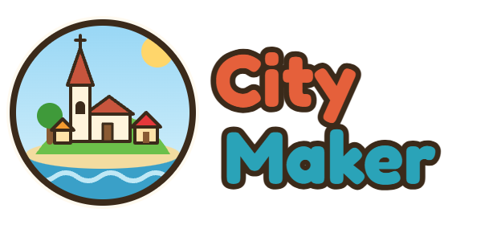
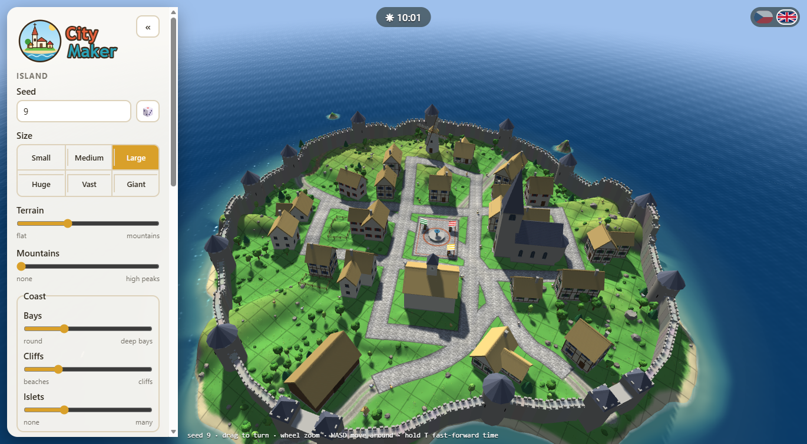
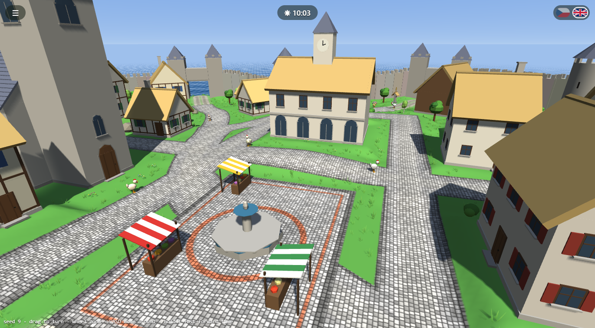
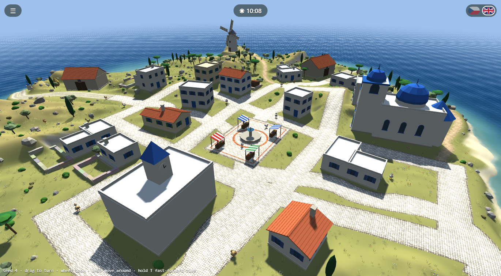
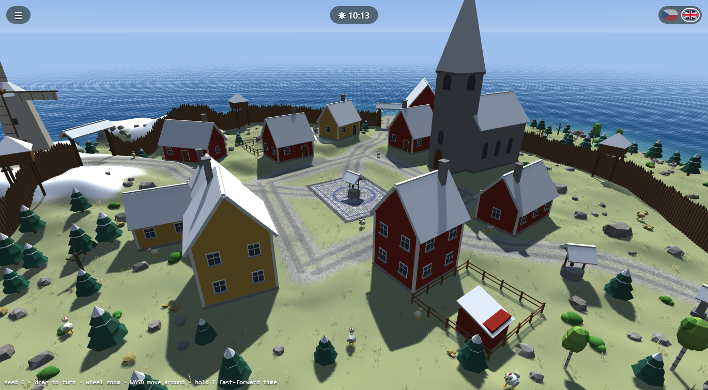
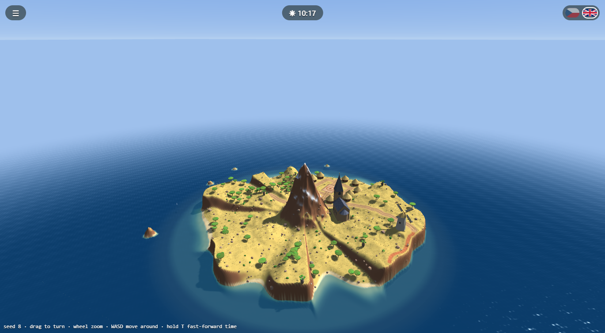

<h1 align="center"></h1>

**CityMaker** generates 3D islands with settlements on them, right in the browser.
Choose the island's size, terrain, vegetation, climate and how big a settlement
it should have, press **Generate**, then look around from above or walk the
streets yourself. Export the result as JSON (to load it back later) or as a GLB
3D model for Blender and other tools.

Today it builds the landscape, the roads and squares, and the buildings of villages
and small towns: houses in seven architecture styles, churches, town halls, market
stalls, windmills, wells and fountains, farms with fields, fences, and town walls with
towers and gates. Bigger city buildings come next (see the [roadmap](#roadmap)).

Everything runs in the browser: plain JavaScript and raw WebGL2, with no
libraries, no build step and no backend. Any static file server will do.



| The market square | A Mediterranean town | A Nordic village |
| --- | --- | --- |
|  |  |  |



## Features

- **An island for every set of options.** The same options always give the same island:
  - **Seed:** any whole number. 🎲 picks a random one.
  - **Size:** small, medium, large, huge, vast or giant (96 to 512 m across).
  - **Terrain:** from a flat plain to hills with sharp ridges.
  - **Mountains:** none, or one or two peaks rising above the hills.
  - **Coast:** how many deep **bays** bite into it, how much of it is **cliffs** rather
    than beaches, and how many rocky **islets** stand offshore.
  - **Vegetation:** from bare to lush.
  - **Climate:** sets the ground colours, the plants and the paving:

    | Climate       | Plants                                                 | Paving                      |
    | ------------- | ------------------------------------------------------ | --------------------------- |
    | Mild          | oaks, birches, pines higher up, meadow flowers         | grey cobbles                |
    | Forest        | dense mixed woods of oak, birch and pine               | grey cobbles, dark earth    |
    | Mediterranean | olive trees, cypresses, umbrella pines, lavender       | white limestone, terracotta |
    | Tropical      | palms along the beaches, jungle trees inland           | pale coral stone, red earth |
    | Savanna       | tall golden grass, flat-topped acacias, the odd baobab | sandstone, red earth        |
    | Desert        | sand dunes, cacti, palms by the water, dry scrub       | sandstone                   |
    | Tundra        | snowy pines, dead trees, snow from a low snow line     | grey granite                |

    High mountains get snowy peaks in every climate except the desert.
  - **Settlement:** none, hamlet, village, town or city (see below).
- **Settlements.** The town goes on the flattest open ground near the middle of the island:
  - **Roads** run from it to the coast, routed around water and steep slopes, and
    join up where they meet.
  - **Paved square:** villages and larger settlements have one, with a pattern in the middle.
  - **Street grid** around the square, which bends a little and stops at steep or wet ground.
  - **Footpaths** lead out to the highest peak and to quiet beaches.
  - **Level ground:** the generator flattens the land under roads and squares.
    Trees and rocks keep off the paving, and towns clear the woods around them,
    leaving room for buildings.
  - **Painted paving:** roads are painted onto the ground, not laid on top of it,
    so crossings merge naturally. Dirt paths fade into the grass at their edges,
    gravel tracks have wheel ruts and a grassy strip down the middle, and streets
    have curb stones and gutters. Up close, a detail texture shows individual
    cobbles, gravel and grains of earth.
  - **Site plan:** a map of what every half metre of the island is used for (free
    ground, water, path, track, street, square, building or yard) and how far it
    is from the nearest paving. The urban planner and the plants use it.
- **Buildings,** placed by the urban planner on the site plan. The **Buildings**
  panel sets the architecture (from the climate, or any style), the density,
  height and shapes of the houses, and which of these the planner may build:

  | Feature            | What you get                                                                                   |
  | ------------------ | ---------------------------------------------------------------------------------------------- |
  | Church & shrines   | a church facing the square, with a tower, an apse and a walled churchyard; wayside shrines on the roads out |
  | Windmills          | one (two in a city) on the highest ground beside a road out of town, its sails turning         |
  | Wells & fountain   | a well on the village square and by the roads; a fountain on a town square                    |
  | Market & town hall | striped market stalls round the square; in towns, a town hall with an arcade and a clock tower |
  | Farms & fields     | barns on the outskirts with haystacks and a field behind: wheat, furrows, vegetables, lavender, vines or millet |
  | Town walls         | stone walls with battlements, round towers and gatehouses round a town; a log palisade with watchtowers round a village. Houses stay inside |

  **Houses** line both sides of the roads, facing them, closer together toward the
  centre: rectangles, L shapes and (in towns) T shapes, one to several storeys,
  many with a fenced yard and some with a shed. The ground under every plot is
  levelled, and buildings are solid when you walk around.

  **Architecture styles:**

  | Style                      | Houses                                                                 | Church     | Default for   |
  | -------------------------- | ---------------------------------------------------------------------- | ---------- | ------------- |
  | Timber & thatch cottages   | whitewashed, many timber-framed, thick thatch, coloured shutters       | spire      | mild          |
  | Log houses                 | log walls with crossing corners, shingle roofs                         | spire      | forest        |
  | Nordic                     | falu red, ochre and white boarded houses, white trim, dark steep roofs | spire      | tundra        |
  | Mediterranean (flat roofs) | white cubes with flat roofs and blue doors and shutters, some tiled    | blue dome  | mediterranean |
  | Adobe                      | flat-roofed adobe with roof-beam ends                                  | bell tower | desert        |
  | Tropical                   | timber under steep palm thatch                                         | bell tower | tropical      |
  | Round huts                 | round mud huts with cone roofs; raised round granaries                 | bell tower | savanna       |

  In the tundra every roof carries snow. Houses are built from a library of parts
  (walls, plinths, windows with sills, mullions and shutters, doors, gable, flat
  and cone roofs, chimneys, timber framing, log courses, towers), so new building
  types are quick to put together.
- **Editor view:** the camera circles the island, and a tile grid (4 m tiles) can
  be switched on or off.
- **Explore on foot** as a beach ball, a tabby cat, a dog or a hedgehog. You start
  on dry land near wherever the editor camera was looking. Everyone can swim.
- **Chickens** wander the island and run from you. **Dolphins** swim offshore.
- **Day and night:** a moving sun and moon, soft shadows, sunsets and stars.
- **Export** as JSON (the whole world, to import again later) or as GLB (a 3D model).
- **Shareable links:** the options are kept in the page URL.
- **English and Czech**, switched with the flags in the top-right corner.
- **Desktop and touch controls**, with an on-screen joystick on phones and tablets.

## Running it

You need Python 3 (only to serve the files) and a browser with WebGL2.

```sh
python serve.py          # http://127.0.0.1:8000
python serve.py 9000     # another port
```

[serve.py](serve.py) is Python's built-in web server with two changes. It always
sends `.js` files as JavaScript (on Windows the registry can map them to
`text/plain`, and browsers refuse to load modules sent that way), and it turns
off caching so your edits show up on reload.

Python's own server works too, run in the project folder: `python -m http.server`,
then open [http://localhost:8000](http://localhost:8000) (the root page forwards to
`static/`). So does any other static file server, and static hosting such as GitHub
Pages.
Opening `static/index.html` straight from disk does not work, because browsers
don't load JavaScript modules from `file://` pages.

### URL options

| Option    | Example           | Effect                                                                         |
| --------- | ----------------- | ------------------------------------------------------------------------------ |
| `seed`    | `seed=42`         | which island                                                                   |
| `size`    | `size=huge`       | `small`, `medium`, `large`, `huge`, `vast` or `giant`                          |
| `hills`   | `hills=80`        | terrain, from 0 (flat) to 100 (mountains)                                      |
| `veg`     | `veg=20`          | vegetation, from 0 (bare) to 100 (lush)                                        |
| `peaks`   | `peaks=80`        | mountains, from 0 (none) to 100 (high peaks)                                   |
| `bays`    | `bays=70`         | bays, from 0 (a round coast) to 100 (many deep bays)                           |
| `cliffs`  | `cliffs=60`       | cliffs, from 0 (beaches all round) to 100 (mostly cliffs)                      |
| `islets`  | `islets=50`       | islets, from 0 (none) to 100 (many)                                            |
| `climate` | `climate=savanna` | `mild`, `forest`, `mediterranean`, `tropical`, `savanna`, `desert` or `tundra` |
| `town`    | `town=city`       | `none`, `hamlet`, `village`, `town` or `city`                                  |
| `arch`    | `arch=nordic`     | `auto`, `cottage`, `log`, `nordic`, `mediterranean`, `adobe`, `tropical` or `huts` |
| `bdens`   | `bdens=80`        | building density, from 0 (scattered) to 100 (packed)                           |
| `bheight` | `bheight=60`      | building height, from 0 (low) to 100 (tall)                                    |
| `bvar`    | `bvar=90`         | house shapes, from 0 (plain) to 100 (varied)                                   |
| `feat`    | `feat=church.mill.walls` | what may be built: `church`, `mill`, `wells`, `market`, `farms`, `walls` (all by default) |
| `time`    | `time=21`         | start at 21:00 (the day starts at 10:00 by default)                            |

For example: `http://127.0.0.1:8000/?seed=4&size=large&hills=35&veg=60&climate=mediterranean&town=town`.
The page updates the URL each time you generate, so you can copy it from the address bar.

## Controls

| Action                 | Editor view             | On foot                                   | Touch                                    |
| ---------------------- | ----------------------- | ----------------------------------------- | ---------------------------------------- |
| Move                   | W A S D                 | W A S D                                   | joystick under your left thumb (on foot) |
| Turn and tilt the view | drag, or the arrow keys | arrow keys, or click to capture the mouse | drag                                     |
| Zoom                   | mouse wheel             | mouse wheel                               | pinch                                    |
| Fast-forward time      | hold T                  | hold T                                    | hold ⏩                                   |
| Back to the editor     |                         | M, or the ← Editor button                 | ← Editor button                          |
| Release the mouse      |                         | Esc                                       |                                          |

A full day lasts 5 minutes. The « button hides the editor panel and ☰ brings it back.

## Exporting

### GLB (3D model)

**Export GLB** saves the island as a binary glTF file, which Blender, Godot,
three.js and most online glTF viewers open. Each layer is its own named object,
so you can hide, edit or replace the layers separately:

| Layer    | Contents                                           |
| -------- | -------------------------------------------------- |
| `island` | the terrain, coloured by height, slope and climate |
| `water`  | a flat, see-through sea over the whole map         |
| `roads`  | paths, tracks, streets and squares: a mesh over the paved ground with the painted paving as its texture |
| `buildings` | every building, fence and town wall; windmill sails at rest |
| `plants` | trees, bushes, rocks, grass and flowers            |

The island, water and plants have their colours stored per vertex; the roads use
the painted paving image (up to 4096 pixels across). Units are metres with Y up.
A large village is about 28 MB. Buildings will get a layer of their own. The animals
are not exported.

### JSON (world file)

**Export JSON** saves the whole world and **Import JSON** loads it back exactly as
it was. An imported world is not generated again from its options, so later
versions can save edits in the same file. A medium island is about 400 KB. The format:

```jsonc
{
  "format": "citymaker-world",
  "version": 4,
  "options": {
    "seed": 1, "size": "medium", "hilliness": 0.4, "vegetation": 0.5, "peaks": 0,
    "bays": 0.3, "cliffs": 0.25, "islets": 0.3, "climate": "mild", "settlement": "village",
    "architecture": "auto", "density": 0.5, "height": 0.3, "variety": 0.5,
    "features": ["church", "mill", "wells", "market", "farms", "walls"]
  },
  "terrain": {
    "tiles": 32,          // tiles along each edge of the square map
    "tileSize": 4,        // metres per tile edge
    "segments": 8,        // grid cells per tile edge
    "heights": [-3, ...]  // (tiles * segments + 1)² heights in metres, row by row along z
  },
  "settlement": {
    "level": "village",   // none, hamlet, village, town or city
    "centre": [44, 68],
    "radius": 30,         // extent of the built-up area
    "angle": 0.52,        // direction of the street grid, in radians
    "squares": [{ "centre": [44, 68], "size": [12, 9], "angle": 0.52, "height": 1.78 }],
    "roads": [{ "type": "road", "width": 3.2, "points": [[x, z, y], ...] }],  // types: path, road, street
    "architecture": "cottage",  // the style the buildings were made in
    "buildings": [{
      "type": "house",    // house, church, hall, mill, well, fountain, stall, barn, shed, haystack or shrine
      "centre": [52.4, 61.9], "size": [8.1, 9.6], "angle": 2.31,  // bounding box; the front faces [sin(angle), cos(angle)]
      "floor": 2.18,      // height of the levelled ground it stands on
      "storeys": 1, "variant": 2, "roof": "gable",  // gable or flat
      "wings": [[0, 2.2, 8.1, 5.2], [2.1, -2.3, 3.9, 5]]  // [x, z, width, depth, storeys?] in the building's own frame
    }],
    "fences": [{ "type": "fence", "points": [[x, z], ...] }],  // fence or wall; closed loops repeat their first point
    "fields": [{ "centre": [x, z], "size": [18, 12], "angle": 0.4, "crop": "wheat" }],
    "fortifications": {   // or null
      "kind": "stone",    // stone or palisade
      "ring": [[x, z], ...], "gates": [{ "x": 38.8, "z": 70.4, "angle": 2.58, "width": 5 }], "towers": [[x, z], ...]
    }
  },
  "props": {
    "trees":   [[x, z, scale, rotation, "oak"], ...],   // oak, pine, birch, palm, cactus, snowPine, deadTree,
                                                        // jungle, olive, cypress, umbrellaPine, acacia, baobab
    "bushes":  [[x, z, scale, rotation, "bush"], ...],  // bush, shrub
    "rocks":   [[x, z, scale, rotation, variant], ...], // variant 0 to 3
    "grass":   [[x, z, scale, rotation], ...],
    "flowers": [[x, z, scale, rotation], ...]
  }
}
```

Positions are in metres from the map's corner, heights in metres above the sea
(the open seabed is at -3), and rotations in radians around the vertical axis.
The terrain heights already include the levelling under roads and squares.
The site plan is not saved, because it is worked out again from the settlement
when a file loads. Older files still load: version 1 without a settlement,
version 2 without buildings, version 3 without fields and walls.

## Roadmap

1. **Landscape** (done): configurable island generator, exploring, JSON export.
2. **Roads and squares** (done): settlements from hamlets to cities, GLB export.
3. **Village and town buildings** (done): houses in seven styles, churches, town
   halls, markets, windmills, wells, farms, fences and town walls, laid out by the
   urban planner and adjustable in the Buildings panel.
4. **City buildings:** terraced houses, guild halls, cathedrals, a castle.
5. **Town walls** and other fortifications.
6. **Settlements that grow** from small villages into towns and cities.

## Tests

```sh
node --test tests/js/*.test.mjs
```

The tests need Node 20 or later and nothing else. They cover world generation
(terrain, coast, settlements, the site plan, buildings and their options, town
walls, plants, options, JSON export and import, GLB export, the paving detail
texture) and
the app logic (collisions, dolphins, avatars, the day/night cycle, input and
translations). They don't cover rendering.

## How it's organised

```
serve.py            static file server for development
index.html          forwards to static/ (for `python -m http.server` in the project folder)
static/index.html   the page: editor panel, avatar dialog, HUD
static/js/
  main.js           app loop and modes (editor view, choosing an avatar, on foot)
  editor.js         the editor panel's form and buttons
  world/            world generation in plain JS (no WebGL), so it also runs in Node
    options.js      generation options, defaults, URL parameters
    noise.js        value noise, fractal and ridged noise
    heightmap.js    the island's heightmap: hills, peaks, bays, cliffs, islets
    heightfield.js  height and slope lookups on a heightmap
    climates.js     per-climate colours, plant rules and paving
    settlement.js   the settlement: site, square, roads, street grid, footpaths, levelling
    pathfind.js     least-cost routes over the terrain (A*)
    siteplan.js     what each spot is used for, and how far it is from paving
    planner.js      the urban planner: walls, church, hall, market, mills, houses, farms, wells, shrines
    architecture.js the architecture styles
    vegetation.js   where trees, rocks, bushes, grass and flowers go
    world.js        generateWorld(), JSON export and import
  terrain.js        terrain mesh, coloured by climate
  pavingpaint.js    paints the paving and fields into map-wide textures (canvas 2D)
  pavingdetail.js   the tileable close-up detail: cobbles, gravel, earth
  scenery.js        tree, rock, bush, grass and flower models, merged into one mesh
  buildings/
    parts.js        building parts: windows, doors, roofs, chimneys, timber framing, towers
    models.js       every building type, fences and yards, built from the parts in a style
    fortifications.js  town walls: stone walls, towers and gatehouses, or a palisade
  layers.js         the world as named geometry layers, for export
  glb.js            binary glTF writer
  gl.js             shaders (lighting, shadows, fog, paving, see-through occluders), meshes, textures
  shapes.js         low-poly primitives the models are built from
  water.js, waves.js, sky.js, skycolor.js, shadows.js, daynight.js
  avatars.js        the four avatars: models, walking, idling and swimming
  chicken.js, dolphins.js
  player.js, input.js, touch.js, collision.js
  i18n.js, langswitch.js, preview.js (live avatar previews)
tests/js/           Node test suites
media/              logo and screenshots
```
